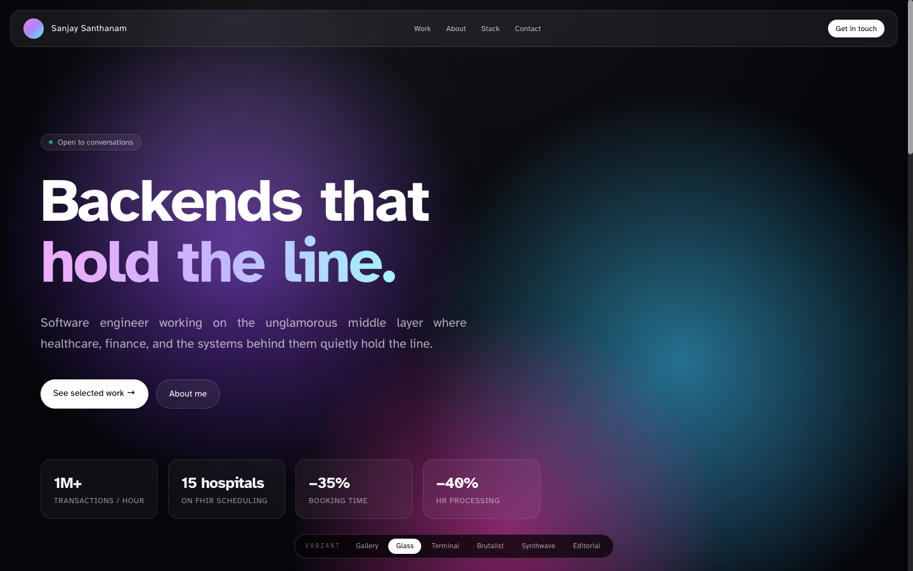
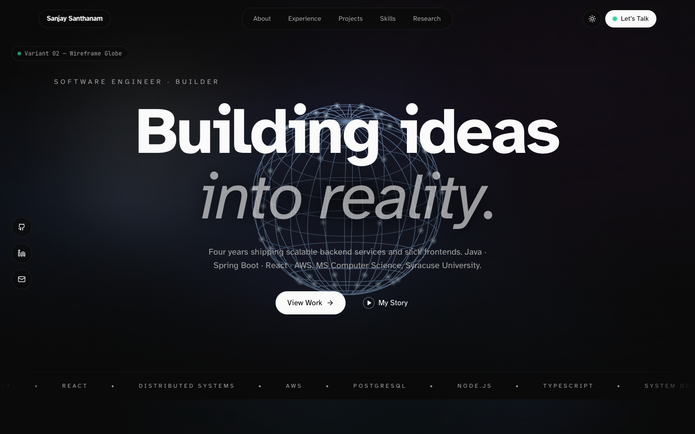
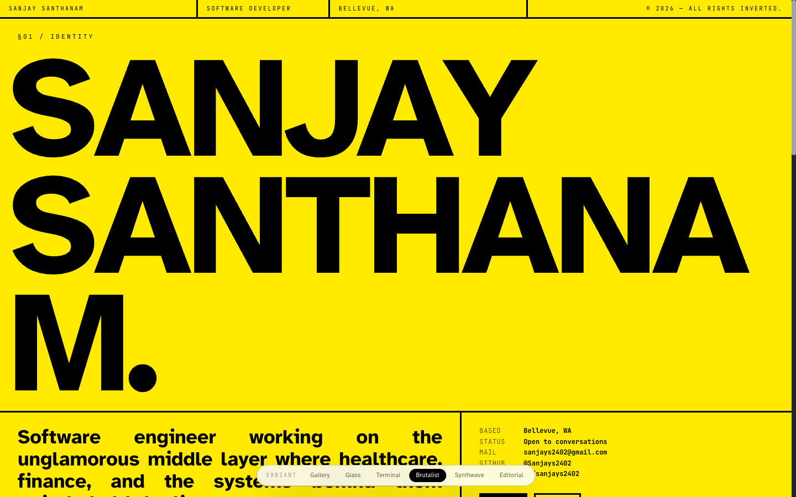
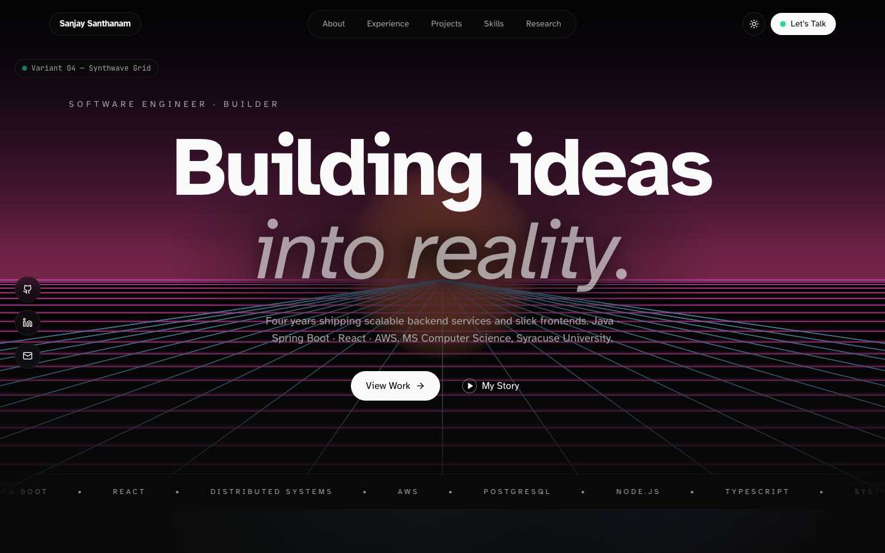

# Portfolio Hero Experiment

Fifteen complete portfolio sites wrapped around the same person.
Built to compare design languages side-by-side — same data, same nav, same CTAs, only the aesthetic changes.

🔗 **Live:** https://sanjays2402.github.io/portfolio-hero-experiment/

## Variants

| Route | Style | Tech / theme |
|---|---|---|
| `/v1` | Glass | Aurora gradients, frosted depth |
| `/v2` | Terminal | CRT, command-line, shell history |
| `/v3` | Brutalist | Yellow, black, no mercy |
| `/v4` | Synthwave | Perspective grid + sun, outrun aesthetic |
| `/v5` | Blueprint | Technical drawing, "Drawing No. SS-2026" |
| `/v6` | Zine | Halftone comic, hand-stapled |
| `/v7` | Museum | Spotlit, serif, hushed |
| `/v8` | Y2K Aero | Frutiger Metro · 2003 |
| `/v9` | Boarding | Sanjay Air · JAI → SEA boarding pass |
| `/v10` | Newspaper | Broadsheet, drop caps, wire copy |
| `/v11` | Receipt | Thermal print, dot-matrix, barcode |
| `/v12` | Subway | MTA line map of a career |
| `/v13` | Bloomberg | Career as a market product |
| `/v14` | Polaroid | Corkboard, washi tape, push-pins |
| `/editorial` | Editorial | Magazine spread, serif |

## Navigating

Every page carries a floating **Variant** switcher at the bottom of the screen —
click any label to jump straight to that variant, or press **← / →** arrow keys
to flip through them in order (gallery → v1 → … → editorial). Arrow keys are
ignored while typing in a text field.

### v1 — Gradient Orb


### v2 — Wireframe Globe


### v3 — Particle Field


### v4 — Synthwave Grid


## Stack

- Next.js 14 (app router, static export)
- Tailwind CSS
- Framer Motion (entrance choreography only)
- Canvas 2D — no three.js, no WebGL libs
- Deployed to GitHub Pages via Actions

## Run locally

```bash
npm ci
npm run dev
# → http://localhost:3000
```

Visit `/` for the gallery, or `/v1`–`/v14` and `/editorial` for individual portfolios.

## Terms & Disclaimer

By using this project you agree to the following.

- **No warranty.** This software is provided "as is", without warranty of any kind, express or implied, including merchantability, fitness for a particular purpose, and non-infringement.
- **No liability.** To the maximum extent permitted by law, the author and contributors are not liable for any claim, loss, or damage (direct, indirect, incidental, or consequential, including lost data or profits) arising from its use.
- **Your responsibility.** You use it at your own risk and are responsible for complying with the laws that apply to you.
- **Third parties.** Names, logos, APIs, and services of others belong to their owners and are used for identification only; no affiliation or endorsement is implied.
- **Your statutory rights.** Nothing here limits rights that cannot be waived by agreement, including under consumer-protection laws in the USA, Canada (including Quebec), and India (Consumer Protection Act, 2019).
- **License.** Use, copying, and distribution are governed by the [LICENSE](LICENSE) file; if anything here conflicts with it, the license controls.

## Content, Assets & Fair Use

- **Original work.** Unless noted otherwise (including below), the code, text, design, and images in this repository were created by the author.
- **Libraries, fonts, and icons.** Third-party libraries, fonts (for example Google Fonts), and icon sets belong to their creators and are used under their own licenses; see the dependency manifests and each source for terms.
- **Logos, brands, and screenshots.** Third-party names, logos, and screenshots appear only to identify or describe their products (nominative use). They remain the property of their owners and do not imply affiliation or endorsement.
- **Ideas and inspiration.** Where this project is inspired by another product, game, or idea, it is an independent implementation. It borrows only general ideas, mechanics, or styles, which are not anyone's exclusive property, and is meant to contain no third-party code or artwork used without permission.
- **Fair use and fair dealing.** Any third-party material is used in limited ways for purposes such as education, research, review, commentary, or identification, relying on fair use in the USA (17 U.S.C. § 107), fair dealing in Canada (Copyright Act, ss. 29–29.2), and fair dealing in India (Copyright Act, 1957, s. 52), where they apply.
- **Concerns and takedown requests.** If you own rights in something here and believe it is used improperly, [open an issue](https://github.com/Sanjays2402/portfolio-hero-experiment/issues) or contact the author through their GitHub profile with a link to the material and your claim. It will be reviewed promptly and credited, changed, or removed as appropriate. You may also use GitHub's DMCA process.
- **Contributions.** By contributing, you confirm you have the right to submit your contribution and agree it is licensed under this repository's license.
- **Website.** The project site has its own [Terms](https://sanjays2402.github.io/portfolio-hero-experiment/terms.html) and [Fair Use](https://sanjays2402.github.io/portfolio-hero-experiment/fair-use.html) pages.
